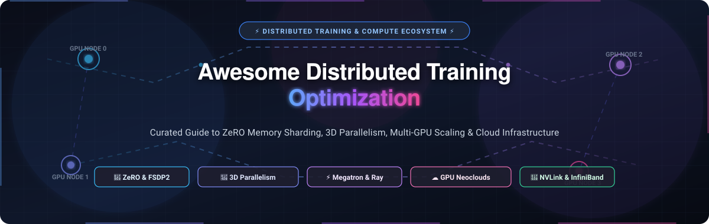
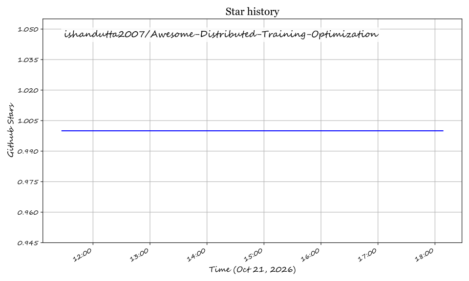

<p align="center">
  
</p>

# 🚀 Awesome Distributed Training Optimization

<p align="center">
  <a href="https://github.com/ishandutta2007/Awesome-Awesome-Awesome"></a><a href="https://discord.gg/jc4xtF58Ve"></a>
  <a href="https://github.com/ishandutta2007/Awesome-Distributed-Training-Optimization/stargazers"></a>
  <a href="https://github.com/ishandutta2007/Awesome-Distributed-Training-Optimization/network/members"></a>
  <a href="https://github.com/ishandutta2007/Awesome-Distributed-Training-Optimization/blob/main/LICENSE"></a>
  <a href="https://github.com/ishandutta2007/Awesome-Distributed-Training-Optimization/pulls"></a><a href="https://github.com/ishandutta2007"></a>
</p>

---

## ⚡ Curated Deep Learning, Memory Sharding & Cluster Orchestration Ecosystem

A curated directory of **leading SaaS platforms** and **open-source frameworks** engineered for **Distributed Training Optimization**. Accelerate foundation model pre-training, LLM fine-tuning, and multi-GPU cluster scaling through cutting-edge memory sharding (**ZeRO**, **FSDP2**), 3D parallelism (**Tensor, Pipeline, Expert, Sequence Parallelism**), and high-throughput network architectures (**InfiniBand**, **EFA**, **NVLink**).

> **Last updated**: October 2026 | **Maintained by**: [@ishandutta2007](https://github.com/ishandutta2007)

---

## 📑 Table of Contents

- [🌐 Sector Overview & Market Dynamics](#-sector-overview--market-dynamics)
- [☁️ SaaS & Hosted GPU Training Platforms](#️-saas--hosted-gpu-training-platforms)
- [🛠️ Open-Source Distributed Training Projects](#️-open-source-distributed-training-projects)
- [🧠 Parallelism & Memory Architecture Reference](#-parallelism--memory-architecture-reference)
- [🤝 How to Contribute](#-how-to-contribute)
- [💖 Support](#-support)
- [⚖️ Disclaimer](#️-disclaimer)
- [⭐ Star History](#-star-history)

---

## 🌐 Sector Overview & Market Dynamics

- **Estimated Market Size**: The global AI infrastructure and distributed deep learning compute market was valued at **~$45 billion in 2024** and is projected to expand to **$180–$220 billion by 2030**, exhibiting a compound annual growth rate (CAGR) of **~32.5%** fueled by foundation model scaling laws, trillion-parameter Mixture-of-Experts (MoE) training, and enterprise custom pre-training.
- **Market Concentration & Dynamics**: The compute layer displays a **highly concentrated, winner-take-most structure** dominated by tier-1 hyperscalers (*AWS, Microsoft Azure, Google Cloud*) and specialized AI neoclouds (*CoreWeave, Lambda*) with capital-intensive access to premier GPU clusters (H100/H200/B200) and ultra-low latency InfiniBand fabrics. In contrast, the software orchestration and memory optimization layer remains **moderately fragmented and vibrant**, where modular open-source runtimes (*DeepSpeed, Megatron-LM, PyTorch FSDP, Ray, Unsloth*) prevent vendor lock-in and enable portable workloads across multi-cloud infrastructure.

---

## ☁️ SaaS & Hosted GPU Training Platforms

The following table compares leading managed cloud platforms and training orchestration services for distributed machine learning workloads. Entries are sorted descending by **Company Valuation / Market Capitalization**.

| 🏢 Platform / Provider | 📊 Company Size (Valuation / Revenue) | 💰 Starting Tier Pricing | 🎁 Free Tier & Trial Limits | 🎯 Primary Distributed Features & Best For |
| :--- | :--- | :--- | :--- | :--- |
| **[Azure ML](https://azure.microsoft.com/en-us/products/machine-learning/)** | **$3.1T** Market Cap (~$245B ARR) | **$0.018/hr** (Standard_B1s CPU) / **$0.90/hr** (NC6 GPU); zero platform markup on Azure VMs | **30-day free trial** with **$200 credit**; perpetual free access to basic Azure ML Studio & 55+ services | Enterprise ML lifecycle, native PyTorch/DeepSpeed integration, Azure Arc multi-cloud cluster management. |
| **[AWS SageMaker Distributed](https://aws.amazon.com/sagemaker/)** | **$2.1T** Market Cap (~$105B AWS ARR) | **$0.0464/hr** (ml.t3.medium) / **$0.21/hr** (ml.m5.xlarge) / **$1.006/hr** (ml.g4dn.xlarge GPU) | **2-month free trial** with **250 hrs/mo** t2/t3 notebooks + **50 hrs/mo** m4/m5 training | SageMaker HyperPod cluster resilience, EFA high-speed interconnect, managed data & model parallelism. |
| **[Databricks Lakehouse](https://www.databricks.com/)** | **$43B** Valuation (~$2.4B ARR) | **$0.07/DBU-hr** (Standard Jobs Compute) + underlying cloud VM infrastructure cost | **14-day free trial** with full compute credits; **Forever-free Community Edition** (15GB RAM cluster, non-GPU) | Unified Spark, MLflow, distributed model training, and petabyte-scale data ingestion in a single environment. |
| **[CoreWeave](https://www.coreweave.com/)** | **$23B** Valuation (~$2.0B ARR) | **$0.24/GPU/hr** (RTX 4000) / **$2.23/GPU/hr** (A100 40GB) / **$4.25/GPU/hr** (H100 PCIe) | **30-day enterprise evaluation** with **$100 free compute credits** upon sales team verification | Purpose-built GPU cloud with 3.2 Tbps NVIDIA Quantum-2 InfiniBand and **$0 egress fees** for massive checkpointing. |
| **[Crusoe Cloud](https://crusoe.ai/)** | **$3.0B** Valuation ($500M+ equity & $3.4B JV) | **$0.85/GPU/hr** (L40S 48GB) / **$2.49/GPU/hr** (H100 80GB SXM) on-demand | **30-day proof-of-concept trial** with **$250 credit grant** upon enterprise onboarding review | Climate-aligned, carbon-negative GPU clusters powered by stranded energy and high-throughput fabric. |
| **[Together AI](https://www.together.ai/)** | **$1.25B–$3.0B** Valuation (~$100M+ ARR) | **$1.85/GPU/hr** (A100 80GB) / **$2.49/GPU/hr** (H100 SXM); fine-tuning from **$0.48/1M tokens** | **$5 free credit grant** on initial signup, valid for **3 months** across serverless fine-tuning and inference APIs | Open-model pre-training, FlashAttention-powered clusters, and dedicated multi-GPU reservation fleets. |
| **[Anyscale](https://www.anyscale.com/)** | **$1.65B** Valuation (Acquired by Nscale) | **$0.05/ACU-hr** (Anyscale Cloud Unit) + cloud VMs / **$1.20/hr** on Hosted Ray Workspace | **30-day free trial** with **$100 in free compute credits** granted upon email verification | Production-grade Ray cluster management, elastic auto-scaling, and fault-tolerant distributed Python execution. |
| **[Lambda Labs](https://lambdalabs.com/)** | **$1.5B** Valuation (~$250M ARR) | **$0.50/GPU/hr** (1x A10 24GB) / **$1.29/GPU/hr** (1x A100 40GB) / **$2.49/GPU/hr** (1x H100 80GB SXM) | **$110 in free research credits** for approved academic/startup labs; **$10 promotional sign-up credit** | Developer-friendly on-demand instances, 1-click Jupyter notebooks, and transparent per-GPU pricing. |
| **[MosaicML (Databricks)](https://www.databricks.com/)** | **$1.3B** Valuation (Acquisition value; parent $43B) | **$1.05/GPU/hr** (A10G) / **$2.49/GPU/hr** (A100); **$0** for open-source Composer library | **14-day free trial** via Databricks with **$300 cloud credit**; **Forever-free open-source Composer library** | Algorithmic training speedups, automated gradient clipping, memory-efficient sharded checkpointing. |
| **[RunPod](https://www.runpod.io/)** | **$130M** Valuation (~$50M ARR) | **$0.20/GPU/hr** (RTX 3070) / **$0.44/GPU/hr** (RTX 4090) Community; **$1.74/GPU/hr** (A100) Secure | **50 hours free CPU pod execution** or **$5 promotional credit** upon initial signup | Cost-effective decentralized GPU clouds, serverless container execution, and custom Docker training environments. |

---

## 🛠️ Open-Source Distributed Training Projects

The following open-source frameworks and libraries power large-scale distributed training, memory optimization, and cluster execution. Sorted descending by **GitHub Stars_Count**.

- **[vLLM](https://github.com/vllm-project/vllm)** [](https://github.com/vllm-project/vllm/stargazers) — High-throughput and memory-efficient LLM serving and distributed RLHF training engine featuring PagedAttention and tensor-parallel execution.
- **[Unsloth](https://github.com/unslothai/unsloth)** [](https://github.com/unslothai/unsloth/stargazers) — Ultra-optimized LLM and vision model fine-tuning engine delivering 2x–5x faster training speeds and up to 80% memory reduction with custom Triton kernels.
- **[Ray](https://github.com/ray-project/ray)** [](https://github.com/ray-project/ray/stargazers) — Unified distributed compute framework with **Ray Train** and **Ray Core** for scaling AI and Python workloads across heterogeneous multi-node GPU clusters.
- **[DeepSpeed](https://github.com/microsoft/DeepSpeed)** [](https://github.com/microsoft/DeepSpeed/stargazers) — Microsoft's premier memory optimization library implementing **ZeRO (Stages 1, 2, and 3)**, ZeRO-Offload, and ZeRO-Infinity for extreme-scale model pre-training.
- **[Colossal-AI](https://github.com/hpcaitech/ColossalAI)** [](https://github.com/hpcaitech/ColossalAI/stargazers) — Comprehensive distributed deep learning system integrating multidimensional tensor parallelism, sequence parallelism, pipeline parallelism, and automated strategy generation.
- **[FlashAttention](https://github.com/Dao-AILab/flash-attention)** [](https://github.com/Dao-AILab/flash-attention/stargazers) — Fast, memory-efficient exact attention algorithm with IO-awareness that eliminates quadratic memory bottlenecks during long-context training.
- **[Megatron-LM](https://github.com/NVIDIA/Megatron-LM)** [](https://github.com/NVIDIA/Megatron-LM/stargazers) — NVIDIA's foundational research framework for scaling Transformer models with tensor, pipeline, sequence, and expert (MoE) parallelism.
- **[Horovod](https://github.com/horovod/horovod)** [](https://github.com/horovod/horovod/stargazers) — Distributed deep learning training framework utilizing ring-allreduce primitives across TensorFlow, Keras, PyTorch, and Apache MXNet.
- **[Axolotl](https://github.com/axolotl-ai-cloud/axolotl)** [](https://github.com/axolotl-ai-cloud/axolotl/stargazers) — Configuration-driven orchestrator for fine-tuning LLMs with multi-GPU/multi-node support, FSDP, DeepSpeed ZeRO, and LoRA/QLoRA backends.
- **[SkyPilot](https://github.com/skypilot-org/skypilot)** [](https://github.com/skypilot-org/skypilot/stargazers) — Cloud-agnostic orchestration framework for launching AI training jobs across AWS, GCP, Azure, Lambda, and Kubernetes with automatic cost optimization.
- **[Accelerate](https://github.com/huggingface/accelerate)** [](https://github.com/huggingface/accelerate/stargazers) — Lightweight Hugging Face library enabling PyTorch models to train seamlessly across multi-GPU, TPU, FSDP, and DeepSpeed configurations with zero code changes.
- **[OneFlow](https://github.com/Oneflow-Inc/oneflow)** [](https://github.com/Oneflow-Inc/oneflow/stargazers) — High-performance distributed deep learning framework engineered around consistent tensors and automatic compilation for parallel scaling.
- **[GPT-NeoX](https://github.com/EleutherAI/gpt-neox)** [](https://github.com/EleutherAI/gpt-neox/stargazers) — EleutherAI's GPU-optimized framework built on Megatron-LM and DeepSpeed for training large autoregressive language models on massive datasets.
- **[TorchTitan](https://github.com/pytorch/torchtitan)** [](https://github.com/pytorch/torchtitan/stargazers) — PyTorch's native end-to-end LLM pre-training repository demonstrating 3D parallelism (FSDP2, Tensor Parallelism, Pipeline Parallelism) in clean PyTorch.
- **[Composer](https://github.com/mosaicml/composer)** [](https://github.com/mosaicml/composer/stargazers) — MosaicML's open-source training library providing 20+ algorithmic speedup methods, progressive layer dropping, and multi-GPU optimization.
- **[FairScale](https://github.com/facebookresearch/fairscale)** [](https://github.com/facebookresearch/fairscale/stargazers) — Meta's PyTorch extension library pioneering Fully Sharded Data Parallel (FSDP), optimizer sharding, and activation checkpointing.
- **[Alpa](https://github.com/alpa-projects/alpa)** [](https://github.com/alpa-projects/alpa/stargazers) — Auto-parallelization system that automatically generates optimal inter-operator and intra-operator parallel execution plans for large neural networks.
- **[GigaTrain](https://github.com/open-gigaai/giga-train)** [](https://github.com/open-gigaai/giga-train/stargazers) — Unified distributed training framework supporting DeepSpeed ZeRO (0/1/2/3), PyTorch FSDP/FSDP2, and DDP with declarative YAML configurations.
- **[ELF](https://github.com/topal-team/elf)** [](https://github.com/topal-team/elf/stargazers) — Research-oriented pipeline parallelism engine featuring a schedule zoo (GPipe, 1F1B, Hanayo, Zero-Bubble) and one-line module wrapping.

---

## 🧠 Parallelism & Memory Architecture Reference

When designing a production distributed training stack, engineering teams choose between memory optimization and computation partitioning:

```
┌────────────────────────────────────────────────────────────────────────┐
│                   3D Parallelism Training Architecture                 │
├────────────────────────────────────────────────────────────────────────┤
│  Data Parallelism (DP / FSDP2)  ──► Shards batches across nodes        │
│  Tensor Parallelism (TP)        ──► Shards individual matrix layers    │
│  Pipeline Parallelism (PP)      ──► Shards model layers across stages  │
│  Sequence Parallelism (SP)      ──► Shards long context tokens         │
│  ZeRO Stage 1/2/3               ──► Shards Opt States, Grads & Weights │
└────────────────────────────────────────────────────────────────────────┘
```

- **ZeRO Stage 1**: Partitions optimizer states across GPUs, reducing memory by 4x with zero communication overhead.
- **ZeRO Stage 2**: Partitions optimizer states and gradients, reducing memory by 8x.
- **ZeRO Stage 3 (FSDP)**: Partitions all model parameters, optimizer states, and gradients linearly with the GPU count.
- **Megatron Tensor Parallelism**: Splits GEMM matrix operations within transformer attention and MLP blocks across NVLink connections.

---

## 🤝 How to Contribute

Contributions are warmly welcomed! Please help expand and refine this ecosystem:

1. **Fork** the repository.
2. Create a new branch (`git checkout -b feature/add-tool`).
3. Add or update entries adhering to existing tables and badge formats (include company valuation, starting pricing, free tier limits, or GitHub stargazer badges).
4. Commit your changes (`git commit -m 'feat: add new distributed training framework'`).
5. Open a **Pull Request** detailing your additions.

---

## 💖 Support

Thank you for exploring and utilizing **Awesome-Distributed-Training-Optimization**! If you find this curated directory valuable for your distributed systems research, ML engineering workflows, or infrastructure planning, here are a few ways you can support the initiative:

- ⭐ **Star this repository** on GitHub to help amplify its reach across the AI community.
- 🍴 **Fork and contribute** new open-source frameworks, benchmark insights, or SaaS platform updates.
- 📢 **Share** this guide with colleagues, ML teams, and on tech communities (X/Twitter, LinkedIn, Discord).
- ☕ **Buy me a coffee / Sponsor**: Support ongoing maintenance, research, and curation via the [GitHub Sponsors Dashboard](https://github.com/sponsors/ishandutta2007):

<p align="center">
  <a href="https://github.com/sponsors/ishandutta2007">
    
  </a>
  <a href="https://github.com/sponsors/ishandutta2007">
    
  </a>
</p>

---

## ⚖️ Disclaimer

- This list is community-curated for informational, educational, and research purposes.
- All trademarks, logos, and brand names are the property of their respective owners.
- When training enterprise models, verify compliance with data security frameworks (SOC 2, ISO 27001, GDPR) and cloud egress limits.

---

## ⭐ Star History

[](https://star-history.dera.page/#ishandutta2007/Awesome-Distributed-Training-Optimization&type=date&legend=top-left)

## ⭐ Star History

<a href="https://star-history.com/#ishandutta2007/Awesome-Distributed-Training-Optimization&Timeline" align="center">
  <picture>
    <source media="(prefers-color-scheme: dark)" srcset="assets/ishandutta2007_Awesome-Distributed-Training-Optimization_growth.svg">
    
  </picture>
</a>
